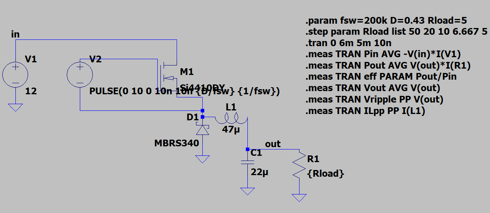
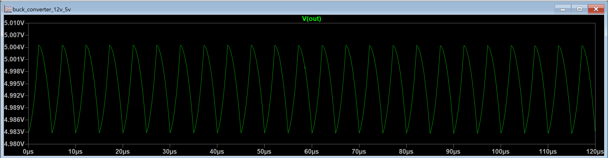
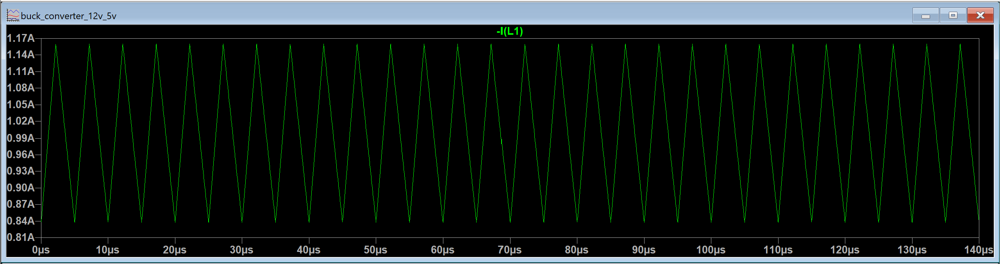
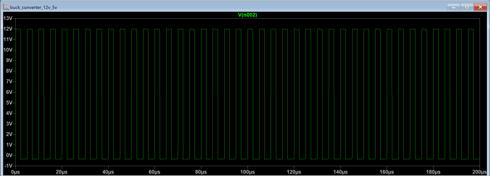

# buck_converter_12v_5v

Design and LTspice simulation of a non-synchronous 12 V to 5 V buck converter switching at 200 kHz. Hand calculations were done first, then checked against a full switching simulation with real device models across a 0.1 A to 1 A load sweep. Hardware prototype is in progress.

**Author:** Madeline Nunn, BsEE student, Mississippi State University
**Status:** Design and simulation complete · Hardware build in progress

## Results at a glance (simulation)

| Metric | Target | Hand calculation | Simulated (1 A) |
|---|---|---|---|
| Output voltage | 5 V | 5 V | 4.99 V |
| Inductor ripple (pk-pk) | ~30% of Iout | 0.31 A | 0.32 A |
| Output ripple (pk-pk) | < 50 mV | ~22 mV (ESR-dominated) | 22 mV |
| Efficiency | > 85% | — | 95.0% |
| Duty cycle | — | 0.417 ideal | 0.43 used |

## 1. Specifications

| Parameter | Value |
|---|---|
| Input voltage | 12 V |
| Output voltage | 5 V |
| Max load current | 1 A |
| Switching frequency | 200 kHz (5 µs period) |
| Topology | Non-synchronous buck (high-side N-MOSFET + Schottky diode) |
| Control | Open loop (fixed duty cycle) |

## 2. Design calculations

**Duty cycle**

Ideal: D = Vout / Vin = 5 / 12 = 0.417

I used D = 0.43 in simulation to make up for the diode drop and conduction losses. This gave 4.99 V at full load.

**Inductor**

L = (Vin − Vout) · D / (ΔIL · fsw)

Targeting ΔIL = 0.3 A (30% of 1 A):
L = (12 − 5)(0.417) / (0.3 × 200 kHz) = 48.6 µH → **47 µH** selected

Resulting ripple with 47 µH: ΔIL ≈ 0.31 A, so peak inductor current ≈ 1.16 A. A real part needs a saturation rating of at least 1.5 A.

**Output capacitor**

ΔVout ≈ ΔIL / (8 · fsw · C) + ΔIL · ESR

With C = 22 µF and ESR = 68 mΩ:
- Capacitive term: 0.31 / (8 × 200k × 22µ) ≈ 8.8 mV
- ESR term: 0.31 A × 68 mΩ ≈ 21 mV

The ESR term dominates. Because the two terms are out of phase, the peak-to-peak ripple lands close to the ESR term rather than their sum.

**CCM / DCM boundary**

I_crit = ΔIL / 2 ≈ 0.16 A. Below this load the inductor current falls to zero each cycle and the converter enters discontinuous conduction mode (DCM).

## 3. Simulation setup (LTspice)

Schematic: [`buck_converter_12v_5v.asc`](buck_converter_12v_5v.asc)

| Component | Model / value |
|---|---|
| V1 (input) | 12 V DC |
| M1 (high-side switch) | Si4410DY N-channel MOSFET |
| V2 (gate drive) | 0–10 V pulse, 10 ns edges, floating on the switch node |
| D1 (freewheeling diode) | MBRS340 Schottky |
| L1 | 47 µH, 50 mΩ series resistance |
| C1 | 22 µF, 68 mΩ ESR |
| R1 (load) | stepped: 50, 20, 10, 6.667, 5 Ω (0.1 to 1 A) |

- Transient run of 6 ms with 10 ns max timestep; measurements taken over the last 1 ms, after startup has settled
- Efficiency = average output power / average input power from V1

## 4. Simulation results

| Load (A) | Vout (V) | Pin (W) | Pout (W) | Efficiency | Output ripple (mV) | Inductor ripple (A) |
|---|---|---|---|---|---|---|
| 1.0 | 4.99 | 5.25 | 4.99 | 95.0% | 22.0 | 0.323 |
| 0.75 | 5.02 | 3.97 | 3.79 | 95.3% | 22.1 | 0.322 |
| 0.5 | 5.06 | 2.67 | 2.56 | 95.7% | 22.3 | 0.322 |
| 0.25 | 5.11 | 1.36 | 1.31 | 95.9% | 22.4 | 0.321 |
| 0.1 | 6.15 | 0.77 | 0.76 | 97.7%* | 23.6 | 0.308 |

*At 0.1 A the output is not regulated to 5 V (see below), so this efficiency is not a like-for-like comparison.

## 5. Discussion

**Hand calculations matched simulation.** 
Predicted inductor ripple was 0.31 A and simulated was 0.32 A. Predicted output ripple was about 22 mV, dominated by capacitor ESR, and simulated was 22 mV.

**Light-load behavior: DCM.** 
At 0.1 A the load current is below the CCM/DCM boundary (~0.16 A), so the inductor current reaches zero each cycle. In DCM the conversion ratio depends on load, and because this design is open loop, the output rises to 6.15 V. A closed feedback loop is needed to regulate the output across the full load range.

**Efficiency is optimistic.** 
The simulated 95% leaves out gate-drive power (the gate source is ideal), PCB trace inductance and resistance, and real switching-edge ringing. Total loss at 1 A in simulation is about 0.26 W, most of which I expect comes from the Schottky diode conducting during the ~57% of each cycle the switch is off. A hardware build is expected to come in lower, and measuring that gap is one goal of the next phase.

## 6. Next steps

- [ ] Build the hardware prototype and measure efficiency and ripple against these simulation results
- [ ] Add closed-loop voltage control to regulate the output in DCM and under load changes
- [ ] Simulate a synchronous version (replace the diode with a low-side MOSFET) and compare efficiency
- [ ] Look at switch-node ringing and its effect on EMI

## Files

| File | Contents |
|---|---|
| `buck_converter_12v_5v.asc` | LTspice schematic with simulation commands |
| `schematic.png` | Schematic screenshot |
| `results_log.png` | LTspice measurement log |
| `vout.png`, `inductor_current.png`, `switch_node.png` | Simulated waveforms |
